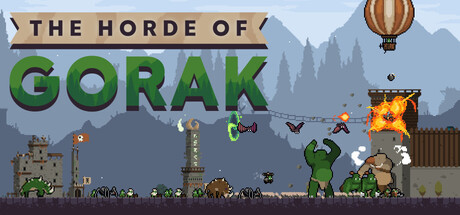
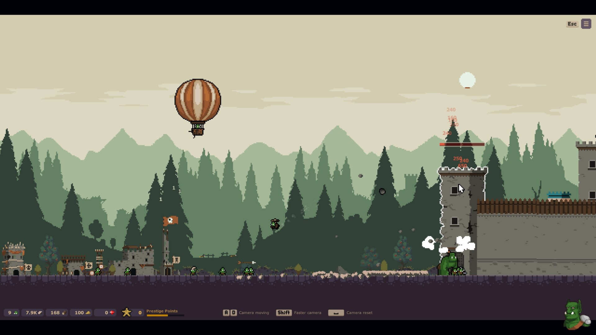
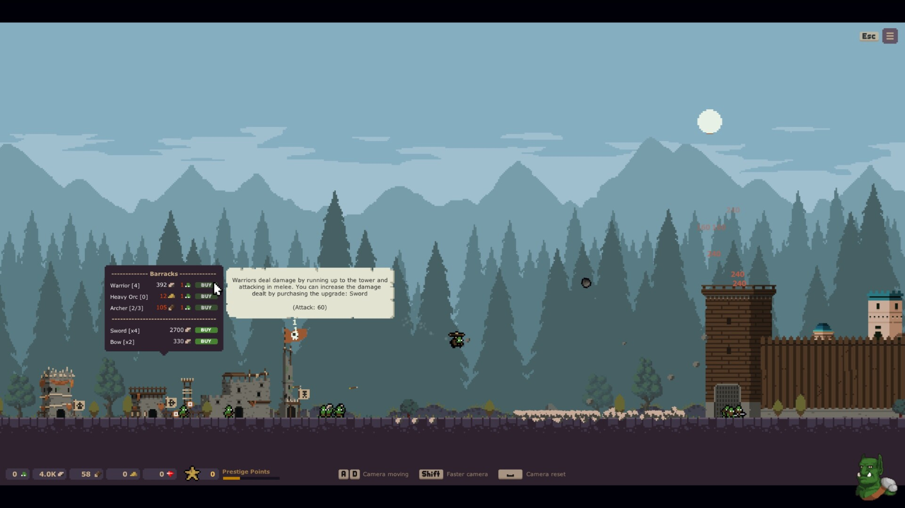
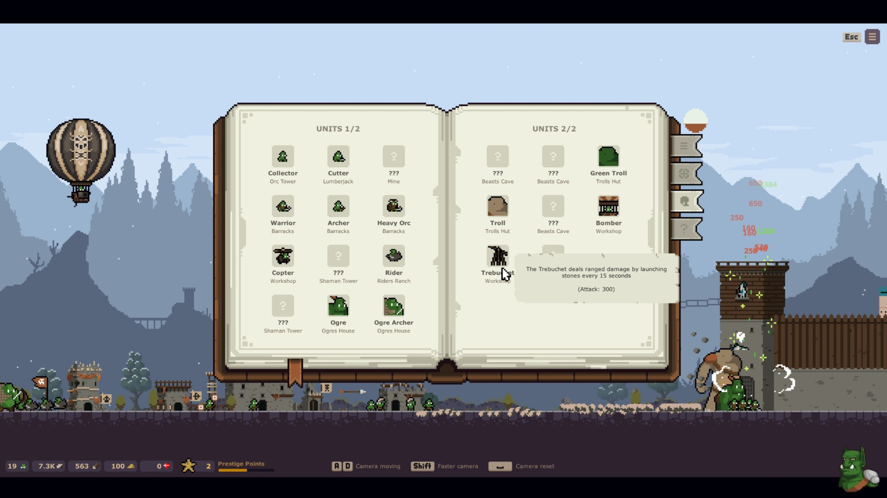
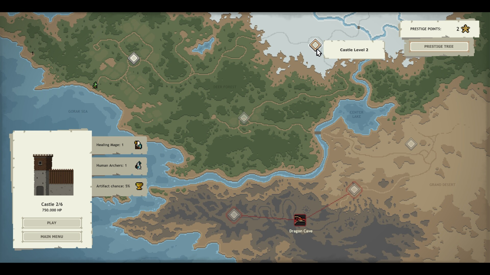
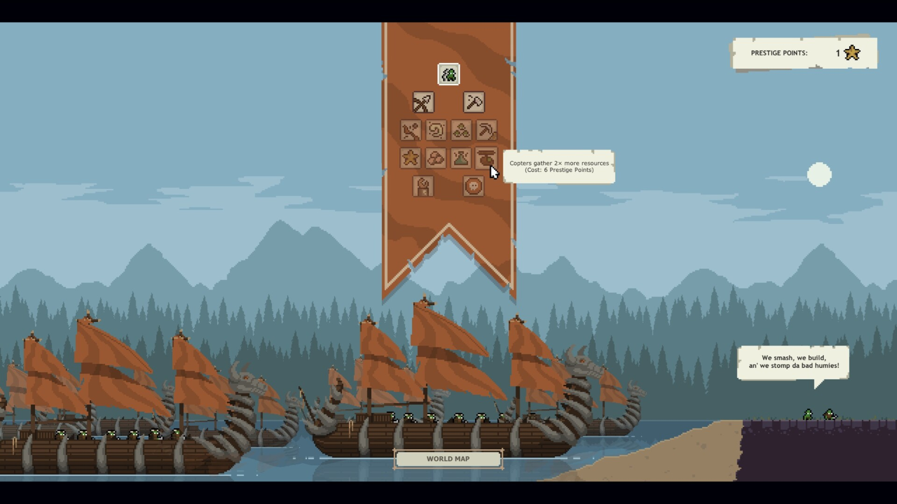

# [게임 소개·리뷰] 오크의 방식으로 대족장을 구출하라, The Horde of Gorak

성 하나를 무너뜨릴 때마다 더 커지는 오크 군단

성을 부숴 번 자원으로 군대를 키우고, 그 군대로 더 단단한 성을 무너뜨린다면 어떨까요?

The Horde of Gorak은 인간에게 붙잡힌 대족장을 구하기 위해 오크 무리를 이끄는 성장형 전략 게임입니다. 작은 야영지에서 출발해 마을과 군대를 키우며 인간의 왕국을 밀고 들어갑니다.

**PC Windows · 싱글플레이 · 마을 성장·병력 강화·공성전 · 픽셀 그래픽**

[공식 Steam 소개](https://store.steampowered.com/app/4911050/The_Horde_of_Gorak/)

## 1. 성벽을 두드릴수록 커지는 군단

*오크 병력과 공중 유닛이 성을 공격하는 공식 화면.*

성을 공격하면 핵심 자원인 성채 파편을 얻습니다. 이를 건물과 병력에 투자하면 다음 공성전을 준비할 수 있습니다.

공격의 성과가 다음 강화로 이어지는 구조입니다. 눈앞의 성벽을 무너뜨리는 일과 군단을 키우는 일이 자연스럽게 맞물립니다.

## 2. 작은 야영지를 전쟁의 기반으로

*마을 건물과 병영 메뉴, 전투 중인 성채가 함께 보이는 화면.*

생산 건물과 군사 시설을 늘리고 강화하며 병력을 뒷받침할 기반을 마련합니다.

지금 공격력을 올릴지, 이후 성장을 위해 건물에 투자할지 고민하게 됩니다. 전투가 벌어지는 화면 안에서 마을도 함께 자라는 모습이 특징입니다.

## 3. 전사부터 공성 병기까지, 늘어나는 선택지

*여러 병종과 공성 병기를 소개하는 책 형태의 유닛 도감.*

전사와 궁수, 더 강한 병력과 공성 병기를 확보해 공격을 보강합니다. 연구와 마법도 군단을 강화하는 수단입니다.

도감에 보이는 다양한 병종은 다음 성장 목표를 떠올리게 합니다. 숫자 증가에 더해 전장에 새로운 병력이 등장하는 모습도 볼거리입니다.

## 4. 대족장을 쫓아 더 깊은 왕국으로

*공략할 성과 지역을 살펴보는 세계지도.*

성을 함락하면 인간들은 대족장을 더 강한 요새로 옮깁니다. 오크 군단은 추격을 계속하며 다음 성에 도전합니다.

지도와 성채 정보는 공성전의 다음 목표를 보여 줍니다. 작은 병력들이 거대한 성을 두드리는 구도와 지역별 배경도 눈에 들어옵니다.

## 5. 다음 원정에도 남는 성장

*명성 점수를 투자하는 특전 목록과 원정 준비 화면.*

원정에서 얻은 명성 점수는 영구 특전에 투자할 수 있습니다. 다음 도전을 더 유리하게 시작하도록 돕는 성장 요소입니다.

눈앞의 성을 공략하는 단기 목표와 이후 원정을 위한 장기 목표가 함께 있습니다. 다시 시작할 때 무엇을 먼저 강화할지도 선택하게 됩니다.

## 짧은 리뷰: 전투와 성장이 한 화면에 담기는 재미

이 게임의 매력은 투자한 결과를 전장의 변화와 연결해 볼 수 있다는 점입니다. 건물을 늘리고 병력을 보강하는 일이 화면 속 오크 무리와 성채 공격으로 이어집니다. 작은 픽셀 병력과 커다란 성벽의 대비도 이 성장 과정을 보기 좋게 만들어 줍니다.

성장 방향을 고르는 재미도 있습니다. 당장 성을 더 빨리 무너뜨릴 전력을 마련할지, 이후 원정에 도움이 될 기반을 챙길지 생각할 여지가 있습니다. 전투를 지켜보는 재미와 투자 순서를 정하는 재미를 함께 찾는 분에게 어울리는 구성입니다.

## 취향이 갈릴 부분: 반복 자체를 즐길 수 있을까

핵심 흐름은 자원을 모으고 강화한 뒤 다음 성에 도전하는 반복입니다. 조금씩 효율을 높이는 과정이 즐겁다면 장점이 되지만, 매번 전혀 다른 사건이나 진행 방식을 기대한다면 단조롭게 느낄 수 있습니다.

따라서 선택의 기준은 이야기의 결말보다 군단을 키워 가는 과정에 얼마나 끌리는지에 있습니다. 이 글에서는 장시간 플레이의 균형이나 엔딩 완성도까지 평가하지 않았습니다.

## 이런 취향이라면 살펴보세요

- 자원을 모아 건물과 병력을 강화하는 과정을 좋아하는 분
- 반복 도전에서 조금씩 효율을 높이는 재미를 찾는 분
- 오크 군단과 공성전을 담은 픽셀 그래픽을 즐기는 분

여러분이라면 먼저 마을을 키우실 건가요, 아니면 병력을 모아 다음 성벽부터 두드리실 건가요?

---

2026년 11월 2일 작성. 공식 게임 설명과 2026년 10월 31일의 주요 화면·기능 검수 기록을 바탕으로 한 소개와 제한된 범위의 리뷰입니다. 전체 회차를 완주한 총평은 아닙니다. 이미지는 공식 Steam 영문 홍보 화면이며 한글패치 적용 화면은 아닙니다.

개발: Digital Deer · 배급: Mad Octopus. 이미지 출처: 공식 Steam 상점. 원본 이미지를 수정하지 않고 사용했습니다.

[정보·이미지 출처: 공식 Steam](https://store.steampowered.com/app/4911050/The_Horde_of_Gorak/)

[한글패치 안내](README.md)
