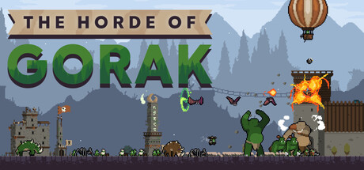

# The Horde of Gorak 한국어 패치 1.0.1

[**한글패치 ZIP 다운로드**](https://github.com/KIMDONGWHEE99/the-horde-of-gorak-korean-patch/raw/refs/heads/main/downloads/THE_HORDE_OF_GORAK_KOREAN_PATCH_1.0.1_r1.zip) · [**게임 소개·리뷰**](INTRODUCTION.md) · [업데이트·검증 안내](releases/v1.0.1.md)

오크 마을과 군대를 키워 인간의 성을 공략하는 성장형 전략 게임의 비공식 한국어 패치입니다. [Steam 공식 상점](https://store.steampowered.com/app/4911050/The_Horde_of_Gorak/)

## 지원 버전

- **Windows Steam 앱 4911050 / 빌드 26365992 / 게임 v1.1.04**에 대응합니다.
- 패치 **1.0.1 · r1**: 업데이트로 막힌 이전 패치를 갱신하고 오우거 상점·금화 등 신규 문구를 추가했습니다.
- 일부 검수를 생략한 버전입니다. 신규 상점 실화면·엔딩·전체 분기는 미확인이며 **전체 검수 통과판은 아닙니다**.

## 설치·제거

1. 게임을 종료하고 위의 **한글패치 ZIP 다운로드**를 누릅니다.
2. ZIP 전체를 새 폴더에 풉니다.
3. `Install.cmd`에서 `THOG.exe`가 있는 게임 폴더를 선택합니다.
4. 설치가 끝나면 Steam에서 평소처럼 실행합니다.

이미 v1.1.04로 업데이트했고 예전 패치 일부가 남아 있어도 그대로 설치할 수 있습니다. v1.1.03이면 게임부터 업데이트하세요. 제거는 **같은 패키지의 `Remove.cmd`**를 사용합니다. 설치 완료 메시지의 원본 백업을 보관하고, 설치 중단 후에는 같은 설치기를 다시 실행해 복구하세요. 설치·제거기는 사용자 저장을 변경하지 않습니다.

저장소의 **Code → Download ZIP**에는 문서와 구버전까지 포함됩니다. 설치하려면 맨 위의 패치 ZIP을 사용하세요.

## 한글화와 확인 범위

- 본문·메뉴 604종 **875위치**, 실행 모듈 표시 문구 **176필드**, 이미지 문구 **4곳**과 한글 글꼴을 반영했습니다.
- 새 버전의 번역 위치·글꼴·픽셀·게임 구조 **12,080개 검사**, 변경 파일 12개 정역 복원, 최종 ZIP 설치·복구 **48개 판정**이 통과했습니다.
- 실제 후보의 메뉴·설정·도입부·지도·전투·저장/이어하기·종료를 확인했습니다. 신규 상점 실화면·엔딩·전체 분기·최종 설치본 추가 실행은 미확인입니다.
- 게임 제목·제작진·브랜드 로고는 유지합니다. 일부 JSON 오류 등 영문 진단 문구가 남아 있습니다.

원본 게임·개인 저장·검수용 변경을 포함하지 않는 차이 패치입니다. 도구·글꼴 라이선스는 ZIP의 `licenses` 폴더에 있습니다. [자세한 확인 범위](releases/v1.0.1.md) · [설치기 시험 요약](releases/v1.0.1-verification.json)

## 게임이 다시 업데이트되면?

**빌드 번호만 바뀌고 검사 대상 파일이 같으면 적용할 수 있습니다.** 파일 내용이 달라지면 새 패치가 필요할 수 있습니다. 설치기는 내용이 다른 파일을 강제로 덮어쓰지 않으며 모든 미래 버전의 호환성을 보장하지 않습니다.

## 소개글과 이전 버전

[게임 소개·리뷰](INTRODUCTION.md)는 공식 이미지 6장과 게임 특징, 짧은 리뷰를 담았습니다. `미리보기.html`, `카페_복사용.html`, `카페_본문.txt`도 제공합니다. 소개 이미지는 공식 영문 홍보 화면이며 한글패치 적용 화면이 아닙니다.

[이전 패치 1.0.0 안내](releases/v1.0.0.md)는 빌드 26336311 / 게임 v1.1.03용입니다.

ZIP SHA-256: `427d383431c9cabc9c84bcaa97193a8e8b415400be33ea973bbaf856fbae0c41`
